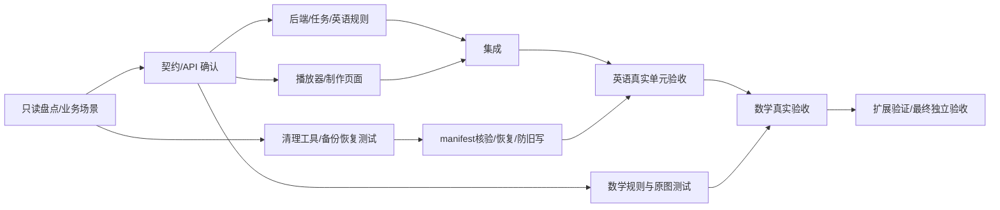

# 教材互动课件执行与独立验收计划

日期：2026-10-11。基线：`38439974`（PR #283）。技术边界以 [课件设计](textbook-courseware-plan.md) 为准。
本轮由主代理制定与验收，三个 Luna（`gpt-6-luna`，`xhigh`）任务分工实施，共享工作区但按文件所有权隔离。
实现、测试与真实内容审查分别记录，不把开发者自报测试或合成样例当作真实教材验收。

## 并行与串行关系

| 阶段 | 可并行工作 | 必须等待的条件 |
| --- | --- | --- |
| P0 基线 | 真实材料/服务/数据库只读盘点；前端布局与现有组件检查；后端契约设计；验收场景设计 | 任何数据写入先确认实际环境；前后端实现接同一契约 |
| P1 契约锁定后 | 后端存储/迁移/Job/规划生成；前端播放器/制作页面；旧产物清理 CLI 与隔离库恢复测试 | 后端先公布 schema/API/版本语义；迁移编号由后端唯一维护 |
| P2 联调 | 前后端联调；英语内容规则；清理清单核验；数学规则与公式/原图场景开发 | 不并行改同一文件；生成类型仅通过 generate:api 更新 |
| P3 英语接受 | 英语真实单元生成与逐页检查；已有试卷/媒体/语音回归；无共享资源冲突的前后端门禁 | 清理 apply 等精确 manifest、备份可恢复、旧任务写入门禁通过；英语发布须教师审核 |
| P4 数学与扩展 | 英语回归与数学规则修复；第三学科注册 smoke 验证 | 数学真实验收按英语接受后推进；未接受时数学只作为未发布开发结果，不扩大自动生成 |
| P5 最终验收 | 独立代码评审、全套门禁、浏览器交互与视觉对照、材料/清理证据核验 | 先完成集成再跑最终门禁；修复后重新验证受影响路径 |

## Luna 文件所有权与交付

| 任务 | 所有权 | 必须交付 |
| --- | --- | --- |
| backend | `apps/api/` 中 courseware 新契约、领域、Store、服务和任务；唯一迁移/数据库 schema/应用、身份与Worker装配所有者 | 先契约清单，再真实持久化闭环、规划确认、逐页生成/恢复/审核发布、学生安全投影/可选练习、来源分流，行为测试与命令结果 |
| frontend | `apps/web/` 课件制作/播放、路由与教材入口、生成类型；新 `routers/courseware_routes.py` HTTP 适配器及边界测试 | 深色图文课件、Deck/Rail、环节/页码、输入/检查列表/揭晓、讲稿/计时/全屏/对比度、局部编辑与重做、状态恢复与错误状态；组件/E2E测试；按后端服务签名暴露类型化端点以提前生成客户端 |
| data | `persistence/legacy_textbook_cleanup_store.py` 及独立 metadata、清理服务、`scripts/cleanup_legacy_textbook_content.py`、相关测试与忽略的盘点证据 | 只读环境与真实材料 inventory；精确 manifest/dry-run、备份/恢复、幂等与关联保护；不自行 apply 共享数据或改迁移/Job公用文件；metadata 导入、迁移及核心读写过滤由 backend 统一接入 |
| 主代理 | 本执行计划、集成协调、架构/API/代码地图/状态文档、独立验收报告 | 审查契约和跨域边界，复核清理前置证据，实际运行门禁和浏览器验收；缺陷退回对应 Luna 修复 |

不创建额外用户聊天。Luna 作为当前任务的子代理工作，任务结束前报告修改文件、实际命令/结果、未验证项与失败路径。
不自行创建分支、提交、推送、发布或部署；本轮代码保留工作区供验收。不得读取或打印凭据，不提交教材、学生数据与验收生成产物。

2026-10-12 恢复执行时，独立清理 Store 一并交给 data，解除其等待 backend 的实现依赖。
双方先固定 tombstone 字段与 inspect/snapshot/apply/restore 契约，backend 继续唯一维护迁移、schema registry 和旧任务写入门禁。
课件 HTTP 适配器随后交给 frontend，按已确认的服务方法签名实现；backend 保留业务语义与装配。
此分工允许在服务内部实现期间先准备 OpenAPI/前端客户端，最终门禁仍必须连接真实服务。

## 独立验收与停止条件

1. 先写 `user_` Given/When/Then 场景：教材含编号练习仍生成课件、试卷保持原题、未知学科待确认、无quiz发布、重复大纲确认、旧租约迟到、修订/删除防回写、版本稳定与答案权限。
2. 在隔离 PostgreSQL 核验迁移/事务/版本/恢复，避免共享业务库。清理前后核对原文件/来源、试卷、学生作答、质量案例、媒体/语音引用。
3. 独立运行 AGENTS.md 全部相关后端、前端门禁及测试纪律检查。无数据库/端口/模型权限时记录具体阻塞，不把跳过报告为通过。
4. 在浏览器实际检查制作→确认大纲→逐页生成→审核→发布→授课/可选练习，附投影与窄屏、封面/暖场两态对照。截图中的 Night Sky 内容只作为设计参考，不作为教材事实来源。
5. 英语真实单元核验来源、目标、词句、图片、覆盖、活动/答案；数学核验条件、公式、教材原图、步骤与解答。主代理的工程/内容检查不冒充认证教师双审。
6. 第三学科只验证可注册扩展和播放器复用，不宣称所有学科已验收。既有媒体/语音不得混用课件发布 ID。
7. 发现串改/契约漂移、答案泄露、旧写复活、清理误选、虚构来源、缺图仍发布或实质回归，暂停相关路径并退回修复；其他独立任务继续。

最终报告按工程通过、真实材料待复核/通过、数据清理实际执行/未执行分别列结论，给出复现实验与可检查入口。

## 本轮执行结果（2026-10-12）

三个 Luna xhigh 子任务完成核心切片；子代理额度不足后，主代理接手真实模型暴露的协议、时长、填空/多选、封面交互、长页布局及最终旧用例修正。英语五页、代数三页、几何五页真实模型本地试点已完成，来源核对、817 项后端、177 项前端和25项 E2E通过。详细证据与范围见[独立验收记录](textbook-courseware-acceptance.md)。

上述验收完成时，代码仍留工作区，正式交付/部署、原库旧产物清理与认证教师复核未执行。原环境旧 Worker 尚在运行，正式清理等待更新运行代码并重新核对 manifest。学科配置扩展 smoke 通过，不代表所有学科内容验收。

## 提交合并阶段（2026-10-12）

用户在本地验收后明确授权提交、推送与合并，取代本轮实施期间的未提交限制。交付分支从最新 main `b3cd1abb` 创建，整合教材复核工作台，保留来源/课程/视频复核入口；生成类型重新由 generate:api 更新。提交范围不包含教材、数据、截图、模型输出或凭据。最新整合的实际门禁结果见验收记录；PR 检查与最终合并状态以 GitHub 为准。此次提交合并不等于已部署、原库已撤回或教师内容审核完成。
