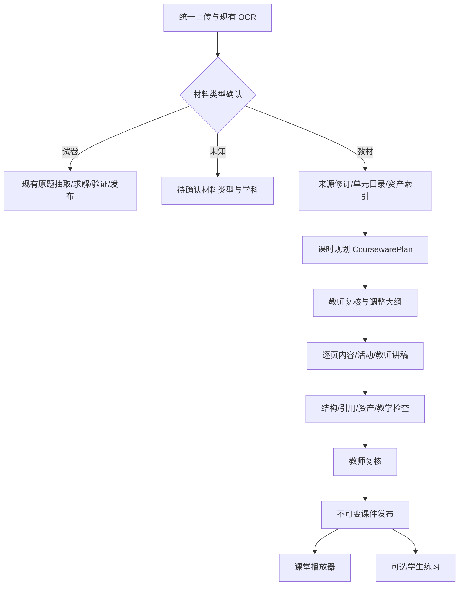

# 教材生成互动课件：实现计划与技术设计

日期：2026-10-11。状态：**待实施**。本次交付仅为计划与技术文档，没有修改生产逻辑或删除运行数据。

最新代码复核：Dotty 工作区已快进同步到 `6f59854c31bf270a183db0a62f12e11ad79e529d`（#282），
OpenMAIC 本地已快进到 `7d324aa84a36360eb42742a8478537d3507f6bb8`。本计划已据这两个远端 main 快照修订；
同步没有安装依赖、运行数据库迁移、重启服务或部署。既有能力的历史验收见 [质量、媒体与语音验收记录](quality-media-voice-acceptance.md)，不等于本次重新验收。

## 1. 目标与范围

教材的默认产物改为可以直接授课的互动课件：有教学目标、课堂环节、图文页面、教师讲稿、课堂活动和总结；教师能够翻页、切换目录、填写、揭晓示范答案和计时。练习是课件中按教学需要插入的环节，允许没有练习，不以题目数量衡量教材生产成功。

试卷仍沿用忠实原题抽取、求解、验证、审校、发布和学生作答链路。不能把试卷改造成自由生成的新课程，也不能因教材中出现编号练习就把整本教材当成试卷。

实施顺序以本次需求为准：**清理旧教材生成结果 → 英语真实教材试点 → 数学教材课件 → 更多学科**。历史数学章节/英语阅读能力作为可复用基础和回归基线，不能视为本次课件已经完成。

第一版交付网页课件；教师可以从“我的教材”打开一本书，按单元、课时进入课件。PPTX、离线 HTML 导出、任意页面自由拖拽编辑、多角色 AI 课堂另行排期。既有教学短视频和步骤语音继续保留；本次规划的是它们与新课件契约的适配，不重复建设视频/STT/TTS 基础。

## 2. 当前实现与问题依据

以下结论来自当前工作区代码，未启动真实模型、OCR 或线上服务。

| 当前路径 | 已有能力 | 本次需要改变的边界 |
| --- | --- | --- |
| `apps/api/domain/chapters/material.py` | `paper/textbook/unknown` 分流和章节边界识别 | 编号题目仍可能触发 paper；未知材料不能直接猜测学科或生产 |
| `apps/api/application/services/textbook_processing.py` | 上传、OCR、试卷题目生产；教材保存原文 | 复用上传/OCR，分流后教材转向课件计划 |
| `apps/api/application/services/material_courses.py` | 前 5 章、单章最多 80 页；创建 tutorial 章节 | 学科最后会回退为 math；只能安排章节草稿，缺少课时与页面计划 |
| `apps/api/application/services/chapter_courses.py` | 来源修订、队列、并发版本、审核、发布 | tutorial 提示词要求中文教程且禁止出题，不能按需插入活动 |
| `apps/api/domain/chapters/quality.py` | 真实页/句引用约束、12,000 字符节选 | tutorial 固定为 objectives/explanation/example/summary 四块 markdown，没有课件页面契约 |
| `apps/web/src/lesson/LessonPlayer.tsx` | 课程块展示、讲解播放、步骤切换 | 过滤 quiz；缺少课件布局、课堂活动、目录和揭晓状态 |
| `apps/web/src/apps/materials/` | 同一本教材聚合目录、软删除、旧练习历史区 | 历史折叠仍保留旧产物；不能代替用户要求的清理 |
| `apps/api/persistence/chapter_store.py` | 章节 JSON、来源历史、recordVersion | 可继续作为来源边界；课件需要自己的文档和不可变发布版本 |
| `apps/api/application/services/quality_review.py`、`quality_review_runs.py` | 不可变来源案例、原页复核、服务端审核身份、有界模型盲评 | 导入课件页快照用于真实质量复核；案例决定不能自动代替课件发布批准 |
| `apps/api/application/services/lesson_media.py`、`apps/web/src/apps/media/` | 来源绑定的教程短视频、TTS、字幕、独立审校与发布 | 目前绑定 chapter/lesson 发布版本，不能直接接收新的 courseware publicationId |
| `apps/api/application/services/voice_tutor.py`、`apps/web/src/apps/voice/` | 已发布非 quiz 步骤的录音、转写确认、追问与取消 | 上下文仍绑定 lessonId/blockId；新课件需只读页上下文适配，不能直接复用 ID |

根本问题是缺少“教学规划 → 页面内容 → 互动与讲稿 → 审核播放”的生产契约；仅替换提示词或增加四段文字，无法达到参考效果。引用 ID 合法只能证明定位合法，内容是否忠实、教学是否成立仍需教师核验。

## 3. 本地 OpenMAIC 参考与适配决策

本次刷新远端并快进同步 `/Users/kiki/work/OpenMAIC`，本地 HEAD 与 origin/main 均为 `7d324aa84a36360eb42742a8478537d3507f6bb8`（2026-10-10）。相比上一轮参考的 `ebf665f3` 增加 148 个提交。下表已按同步后的实际文件重查；未运行其模型生成或教学验收。

| 已核对的 OpenMAIC 代码（相对其根目录） | 实际思路 | Dotty 的采用方式 |
| --- | --- | --- |
| `lib/document/extractors/pdf.ts`、`lib/types/generation.ts` | 文档解析产物与图像元数据独立，图像关联来源文档/页码/资产 | 继续使用 Dotty 的 OCR、来源修订和资产路径，补齐课件资产引用 |
| `packages/@openmaic/generation/src/outline-types.ts`、`packages/@openmaic/generation/templates/requirements-to-outlines/system.md` | 根据目标、受众、时长生成有顺序、目标、预计时长的 SceneOutline；场景分 slide/quiz/interactive/pbl | 采用按课时规划 slide/activity/quiz 的分层大纲，保存教师可编辑的中间产物 |
| `lib/server/generation/run/engine.ts`、`plan.ts`、`store.ts`、`document.ts` | 服务端阶段状态机；内容/动作/旁白有检查点；租约代际限制旧 Worker；页面写入与检查点同事务 | 扩展现有 Dotty JobStore/Worker；检查点、页结果与任务认领校验原子保存，禁止浏览器另发一套生成 |
| `app/api/generation-runs/route.ts`、`app/api/generation-runs/[id]/confirm-outline/route.ts` | 服务端启动生成；大纲确认绑定 outlineRevision 与 commandId；等待确认不占 Worker | 大纲必须由教师显式批准；确认版本与操作幂等键共同防止重复派发，不采用自动倒计时批准 |
| `packages/@openmaic/generation/src/scene-generator.ts`、`lib/server/generation/steps/scene-content.ts`、`scene-actions.ts` | 公共生成包与应用 Step 服务分离，内容与动作分别生产 | 逐页结构化内容、讲稿与揭晓步骤独立；通过现有 Runtime 边界执行，局部重做 |
| `packages/@openmaic/generation/templates/slide-content/system.md` | 幻灯片使用简短视觉内容，长讲解放到讲稿；公式使用独立元素 | 使用受控响应式布局和现有公式渲染；不让模型直接决定任意像素坐标 |
| `packages/@openmaic/generation/templates/quiz-content/system.md` | 测验有选项、分析、分值/评分建议 | 仅用于教材中的形成性练习；答案需审核，复用 Dotty 题型与判定边界 |
| `lib/server/generation/run/media.ts`、`types.ts` | 媒体有独立检查点；已提交的外部视频任务在接管时继续轮询，不重复提交 | 图片、朗读和后续视频分别保存任务/资产状态；完成内容的重试不触发全页重新计费 |
| `lib/server/materials/extraction.ts`、`lib/server/material-extraction/runner.ts` | 上传后后台解析，缓存按内容与解析服务身份复用；材料释放和课程资产分开 | 复用 Dotty OCR 缓存；解析身份参与缓存键，删除派生课件不连带删除教材原件 |
| `lib/server/sanitize-scene-content.ts` | 输出内容经过渲染安全处理 | 第一版只接受类型化 JSON 与现有安全文本/公式/资产组件 |

OpenMAIC 的通用生成提示词不是教材忠实性或答案正确性的证明。本项目不直接使用其 Quiz 提示词处理试卷；英语原文、数学条件和来源证据仍执行 Dotty 门禁。暂不接入其任意 HTML 模拟、PBL、多角色动作系统或 Next.js 存储栈。

本地 OpenMAIC 的 `LICENSE` 为 MIT。第一版优先适配上述流程与契约思路；如后续直接复制代码/模板，须记录文件来源、参考 commit 并保留对应许可与版权说明。

### 3.1 同步最新代码后的计划调整

| 原判断/缺口 | 最新证据 | 修订决策 |
| --- | --- | --- |
| 参考 OpenMAIC 浏览器场景生成与旧 SSE 路由 | `use-scene-generator.ts`、`scene-outlines-stream/route.ts`、`lib/server/scene-generation.ts` 已删除，主链路为 generation run | 全部替换为服务端 run/steps 的当前路径，前端仅订阅结果与发命令 |
| 来源质量复核需从零建设 | Dotty #282 已实现冻结案例、原页预览和复核/盲评工作台 | B1/B2 接入现有质量复核模块，仍单独维护课件页面批准与发布门禁 |
| 视频与语音均待实施 | Dotty #282 已有 lesson media 与步骤 voice；公开记录仍限定工程验收 | 路线图改为既有基础；课件到媒体/语音的来源适配单独安排，不声称自动兼容 |
| 仅检查来源许可 | ChapterSource 新增 sourceTitle/sourceUrl/attributionText，并纳入来源指纹 | 课件草稿/发布/媒体快照携带完整归属与分发范围，页面显示实际 PDF 页序 |
| 阶段重试/取消说明偏粗 | OpenMAIC 将阶段结果、页面与 checkpoint 原子写入，认领带租约 generation | B1 必须覆盖中断接管、旧认领写入、重复确认和媒体重试的行为验收 |
| 清理主要考虑章节与练习 | 新增媒体、语音和质量复核均引用既有来源/发布/步骤 | B0 manifest 盘点新增关联，保留冻结证据和学生语音记录，禁止级联误删 |

总体产品方向、截图交互目标和英语 → 数学 → 学科扩展顺序保持不变。新增基础没有实现多页互动课件，固定四段 tutorial 与 LessonPlayer 的缺口仍存在。

## 4. 用户流程与截图验收目标

### 4.1 制作流程

1. 上传教材或试卷。材料类型、学科、年级/学习者水平允许教师修正；类型不明时停在待确认。
2. 教材显示真实单元目录、页段、OCR 问题和当前可处理范围。默认选择首个完整单元试做，可继续生成后续章节。
3. 输入课时、授课语言、教学目标；先生成并复核课时/页面大纲。默认课时建议为 40 分钟，可调整，不套用截图中的固定单元、词数和页数。
4. 按大纲生成图文页面、讲稿、活动；展示已完成页与失败页，支持单页编辑/重做。
5. 教师核验教材覆盖、英文/数学内容、图像与答案；复核通过后发布不可变课件版本。
6. 进入授课模式；需要学生独立练习时打开对应练习入口。讲解页不会要求提交答案才能翻页。

### 4.2 参考图对应的页面与交互

参考图只提供视觉与交互目标，其中具体文字不作为英语教材的内容依据。

| 参考效果 | 第一版验收要求 |
| --- | --- |
| 封面左文右图，单元主题与双语说明 | 封面包含真实单元、目标、主题图与来源范围，16:9 投影主视图；窄屏纵向重排 |
| 底部五段课堂时间条 | 环节导航与预计时长来自课时计划；点击跳转，总时长校验一致 |
| Deck/Rail 切换、页码与进度点 | 幻灯片模式和侧栏目录模式，共用同一页面状态，支持前后页与快捷键 |
| 暖场先写三样再讨论 | 可填写输入区、数量反馈、同伴检查列表；填写数表示参与进度，不当作正确率 |
| “示范语块”折叠与答案揭晓 | 默认收起，可按页/按步骤揭晓；切页保留输入及揭晓状态 |
| 词卡、配对、词形、听读、填空与自检 | 由教学目标选择页面/活动组合；不强制每单元都出现同一组活动 |
| 计时、讲义、全屏、对比度、重置 | 可暂停计时、打开教师讲稿、全屏与高对比度；重置需明确范围，不能误删课件 |

页面正文、教师讲稿和答案是三个独立视图。输入框内的左右箭头、R/M/T 等按键不得被全局翻页/揭晓快捷键抢占。投影模式和学生练习模式的答案权限分别处理，不能靠 CSS 隐藏答案。

## 5. 目标架构与生成阶段



### 5.1 阶段输入、输出与质量门禁

| 阶段 | 输出 | 失败与恢复规则 |
| --- | --- | --- |
| S0 来源识别 | sourceRevision、真实目录、页码、句子/图像/公式资产 | 缺页、错图、不可读阻止受影响内容生成；未知学科要求确认，取消 math 默认回退 |
| S1 单元分析 | 学习目标、关键词/概念、教材示例、可用活动、coverageMap | 按结构切分完整单元，不仅取最前 12,000 字符；记录未覆盖范围 |
| S2 课时规划 | CoursewarePlan：课时、环节、页型、目标、来源、时长、练习理由 | 先校验结构、时长和覆盖；教师可删改重排，批准后进入逐页生成 |
| S3 逐页生产 | 页面正文、讲稿、展示步骤、可选活动/题目、资产绑定 | 每页只接收对应来源片段和必要上下文；单页失败不重做全单元 |
| S4 校验与复核 | issues、内容版本、审核记录 | 结构/定位确定性检查；语义与教学核验人工负责，LLM 复审只提供建议 |
| S5 发布与播放 | CoursewarePublication、课堂状态、可选练习结果 | 只发布已审核版本；重新生成产生新草稿，保留已发布快照 |

长单元先对有界片段分析，再汇总覆盖索引并分课时；片段都保留原 sentenceId/regionId。每个学习目标映射到来源范围与页面；未处理内容标记 pending/excluded，并说明排除原因。页数不等于教材覆盖率。

首版保留当前最多前 5 章、单章 80 页的资源边界；默认先做一个完整单元。边界不足、单元超过读取上限时，明确提示部分范围并允许教师选择完整课时页段，不声称整章或整本已经完成。后续批次扩大范围需单独测试成本与恢复能力。

### 5.2 任务、并发和审计

- 继续使用 PostgreSQL JobStore/Worker、租约、取消、重试、RuntimeSnapshot；规划和逐页生成成为阶段任务，保存阶段结果及父子任务关联。
- 计划确认时记录 planVersion/expectedRecordVersion/commandId，同一命令返回同一批任务；待教师批准时计划进入 awaiting_confirmation，不保留运行租约，不用时间到期代替教师批准。
- 页面结果和对应阶段 checkpoint 必须在共享数据库事务内提交；恢复根据检查点推进，不凭页面数量猜测完成。写入核对 Job 的 leaseOwner、attemptCount、有效租约与取消状态，解决同一 Worker ID 重新认领时旧调用仍在返回的问题；不额外引入另一套队列。
- 幂等键包含 sourceRevisionId、planVersion、pageId、内容版本、prompt/schema 版本与生成参数；重试复用已成功页，显式重做产生新版本。
- 写入前同时核对章节 recordVersion、计划版本、来源修订、目标页版本和删除状态。教师编辑、改来源或清理旧数据后，过期 Worker 输出不得回写。
- 初始单单元最多并发生成 2 页，通过现有全局 Runtime 限制；取消父任务需取消尚未完成的子任务。媒体/TTS 分开处理，缺失非必要媒体可降级，必须的教材图像缺失阻止发布。
- 模型选择由服务端冻结 RuntimeSnapshot，前端不能在重试时换入未审计参数。后续若接入异步视频供应商，检查点保存 provider/model/endpoint/taskId 并续轮询；仅当旧任务确实失败或明确重做时重新提交。
- `sourceReadiness/generationStatus/reviewStatus` 分开，避免“任务成功”被展示为“课件可发布”。混合成功保存明确的逐页状态与错误。
- 课件业务状态为 draft → in_review → ready → published；request_changes 回到 draft，编辑已批准页面撤销相应批准。生成阶段另用 queued/running/partial/failed/completed/cancelled；软删除优先于任何生成状态，学生只读取已发布快照。
- 规划、英语页、数学页、活动和讲稿提示词纳入现有 `apps/api/prompts/` 与 PromptStore，冻结 templateId/version/contentHash；审计模型、来源、schema、资产和重做原因。

## 6. 课件契约、存储与接口

### 6.1 数据模型决策

增加独立的 CoursewarePlan/CoursewareDocument/CoursewarePublication 契约与 CoursewarePlayer。章节仍管理来源、目录及上传关联，试卷继续使用 LessonDocument/QuestionPayload。第一版不把多页课件塞进单题 questionPayload，也不改变现有 LessonBlock 的所有消费者。

层级：**uploadId（一本教材）→ chapterId（真实单元/章节）→ coursewareId（一个课时）→ pageId → blockId/activityId**。一个单元可有多个课时，一个课时可有多道可选练习。

| 契约 | 关键字段与约束 |
| --- | --- |
| CoursewarePlan | schemaVersion、chapterId、sourceRevisionId、subject、audience、languagePolicy、sessions、objectives、coverageMap、recordVersion；课时中含有序环节与页面大纲 |
| CoursewareDocument | coursewareId、planVersion、sourceRevisionId、subject、title、durationMinutes、sections、pages、assets、reviewIssues、recordVersion、status |
| CoursewarePage | pageId、sectionId、pageKind、layout、objectiveIds、sourceRefs、blocks、teacherNotes、revealSteps、estimatedMinutes、reviewStatus |
| Activity | activityId、kind、instructions、responseSchema、assessmentMode、questionRefs、practiceReason；练习关联学习目标和来源 |
| SourceRef | 使用现有 sourceRevisionId/page/sentenceId/regionId；图像补 assetId，校验其归属，原句由服务端恢复 |
| AssetRef | assetId、kind、origin、sourceRefs、license、attributionText、distributionScope、alt、status；origin 区分教材原图、教师提供和教学插画 |
| Publication | publicationId、coursewareId、version、sourceRevisionId、sourceTitle/sourceUrl/attributionText、distributionScope、snapshot、publishedAt、reviewRecords；快照不可变 |

pageKind 首版支持 cover/explanation/vocabulary/reading/worked_example/activity/practice/summary；layout 限定 hero_split/two_column/cards/text_focus/figure_focus。不同页型复用同一布局，不让模型生成 CSS、JavaScript 或任意 HTML。

block 使用判别联合，支持文本、图像、公式、词卡、输入、检查列表、揭晓区和已有题型适配；各类 payload 都有字段与长度限制，禁止以无限制 dict 代替语义校验。正文中的教材事实/例题绑定真实来源；新增教学活动标记 teacher_authored/ai_supplement，注明依据与复核状态，不能伪装为教材原文。

### 6.2 最小持久化方案

- 复用 ChapterStore 管理来源；章节响应增加 `contentMode=courseware`、课时摘要与 `coursewareIds`。保留旧 teachingMode 兼容读取，不静默把旧 tutorial 当成新课件。
- 新增 `courseware_records` 存放计划与草稿 JSON、章节关联、recordVersion/status/deletedAt；用 recordType=plan/document 区分记录，计划以章节为边界，课时文档作为独立记录，避免多份活动或题目真相源。
- 新增 `courseware_publications` 保存不可变快照；发布、更新当前发布指针在同一事务内，采用现有 advisory lock 与乐观并发规则。
- 需要持久化学生练习时新增 `courseware_attempts`，外键指向课件发布快照，保存 pageId/activityId/questionId、learnerId、答案、证据与判定。现有 `chapter_english_attempts` 外键指向 `lesson_publications`，不能直接填入课件 publicationId。
- 题目评估复用已有纯判定逻辑/应用边界；不伪造 LessonPublication 以迁就外键。是否记入 mastery 需明确知识点与证据语义；第一版仅记练习结果，不把暖场、翻页或自检勾选计入掌握度。
- 使用 Alembic 迁移，不新建数据库或引入新存储服务；不把教材正文、图片或生成结果提交到 Git。
- 当前迁移链已到 `0022_quality_review_compat`，新迁移接在最新 head，不复用 0017–0022 的版本号。保留已导入 quality_review 包、媒体和 voice_sessions 的兼容读取。
- 课件审核 actor 从服务端身份生成，继承既有 identityVerified 边界；demo/共享教师批准可用于现有演示工作流，但不成为独立双审或正式人工金标准。不能把用户填写的 reviewer 字符串当成经过认证的身份。

### 6.3 拟新增/调整接口（全部待实现）

| 方法与路径 | 职责 |
| --- | --- |
| POST `/api/chapters/{chapter_id}/courseware-plan` | 带 subject、languagePolicy、时长/目标、expectedRecordVersion 创建规划 Job |
| GET/PUT `/api/chapters/{chapter_id}/courseware-plan` | 获取/编辑当前计划；PUT 必须带 expectedRecordVersion |
| POST `/api/chapters/{chapter_id}/courseware-plan/approve` | 批准指定计划版本并安排课时生成，复用后台任务响应契约 |
| GET `/api/courseware/{courseware_id}` | 受保护的教师草稿、讲稿、审核、逐页状态 |
| PUT `/api/courseware/{courseware_id}/pages/{page_id}` | 保存页面编辑，要求预期文档/页版本，修改后撤销该页批准 |
| POST `/api/courseware/{courseware_id}/pages/{page_id}/regenerate` | 局部重做，创建有版本快照的 Job |
| POST `/api/courseware/{courseware_id}/review` | 指定页或整课时 approve/request_changes，记录教师身份与版本 |
| POST `/api/courseware/{courseware_id}/publish` | 校验来源许可、完整性、审核与必需资产，返回不可变发布标识 |
| GET `/api/courseware/{courseware_id}/published` | 学生投影：不包含未揭晓答案、判分依据或私有教师讲稿 |
| GET `/api/courseware/{courseware_id}/presentation` | 教师授课投影：指定发布版本，可获取讲稿/揭晓内容，执行现有内容访问保护 |
| POST `/api/courseware/{courseware_id}/attempts` | 学生可选练习提交：绑定 publicationId，复用 learner 身份、幂等与客观判定 |
| DELETE `/api/courseware/{courseware_id}` | 可恢复删除派生产物并取消生成；不得删除上传原文件或试卷 |

任务查询、取消与重试复用已有后台任务 API；冲突返回 409，参数错误 422，删除或不可见对象遵循现有 404 策略。生成类型一律由 OpenAPI 生成。实施时同步 `docs/api.md` 的实际端点表，本文不能当成可调用接口文档。

## 7. 英语、数学与学科扩展

### 7.1 英语首个完整试点

- 选已有真实英语教材中来源清晰、OCR 完整的一个单元；先盘点原文件与页段再选择，不固定使用参考图的 Night Sky 文本。
- 支持词汇、阅读、语法/句式和语言运用课时。目标语言保留英语，中文用于说明与支架；必须在 languagePolicy 中明确，不再一律转成中文讲解。
- 基于教材原词、原句与语境生成词卡、分类、搭配、词形、听读、阅读定位、输出任务与总结；图像承担教学目的，不能只加装饰图。
- 暖场输入、同伴检查、自由表达属于 activity，允许示范答案和教师评价，不强行判为唯一答案。词义配对、选择、填空等才进入客观 quiz。
- 教材包含音频或脚本时绑定对应资产；缺原音频可用已有 TTS 做“合成朗读”，明确来源，不冒充教材原录音。发音评分和英语作文总评分不纳入首版。
- 教师确认词义、词性、搭配、例句、中文支架、答案变体与推断证据；来源不足或开放答案无法可靠自动判断时进入 needs_review。
- 将真实生成页及其输出版本映射成现有 quality_review 案例，复用原页/摘录核对与不可变意见；正文编辑产生新案例修订。模型对比复用既有有界 quality_review_runs，不建设第二套评测台，也不把案例 accepted 自动当作课件已批准。

### 7.2 数学第二批

- 选一个代数单元和一个依赖图形的几何小节，覆盖公式与原图两类边界。
- 课件按情境/概念 → 条件与表示 → 教材例题分步 → 可选练习 → 方法总结编排。每步保留条件、公式、单位和来源；步骤可依次揭晓。
- 复用 RichText/MathText/KaTeX、现有几何渲染和题型组件。教材原图与“示意图”分开；无法忠实支持的图形先展示原图，不用通用三角形替代。
- 原教材例题的解答与生成变式分别验证。新增变式标记 ai_supplement，关联原知识点与适用条件，教师批准后成为 quiz；不可修改原题条件却仍标记“教材原题”。
- 缺条件、错图、公式不可读、单位矛盾、答案不一致均阻止相应页面发布；没有足够验证能力时保留 needs_review，不用模型自评当正确性证明。

### 7.3 扩展机制

公共内核管理来源、计划、页面、活动、任务、审核、播放和版本；英语与数学分别提供分析规则、规划提示词、校验器和支持的页型。出现两套实现后用小型 SubjectProfile 注册表分派，未知 subject 返回“待配置学科”，不回退数学。

第三学科通过一个小节契约验收：例如科学支持实验条件/观察活动，历史支持时间线/史料证据。新增 profile 可复用播放器和绝大多数页型；特殊组件按需增加，不提前设计所有学科的复杂 DSL。保留有限学科白名单，并在新增学科时同步请求/响应契约与 subject 列长度。

### 7.4 既有媒体/语音的接入边界

朗读直接复用现有 TtsRuntime、语言 health 和播放函数。视频继续使用 `lesson_media` 的独立版本、渲染器、字幕、人工批准与分发门禁；新课件若要制作视频，增加 CoursewarePublication 到来源分镜的显式适配，不能把新 publicationId 填入旧 lessonId/publicationId 契约。课件页多于既有 3–8 分镜时应规划独立短视频段落，不能任意丢页。

步骤语音继续使用现有 STT、草稿确认、generation 取消与会话恢复。接入课件时增加页/block 到只读上下文的适配，恢复键包含 courseware publicationId/pageId/blockId；quiz、答案与私有讲稿不进入学生追问。B1/B2 保留既有课程媒体/语音的可用入口与回归，新的课件媒体/语音适配安排在 B4 或专项后续，不作为英语图文课件首试的前置条件。

既有质量复核、媒体和语音的历史实际测试结果见对应实施/验收文档；本轮仅静态检查代码，不把那些旧结果重新报告为本轮运行通过。

## 8. 图片、课堂状态与练习策略

资产优先级：教材中相关原图 → 教师提供的授权图 → 经复核的教学插画。课件通过 assetId 使用现有受控资源接口，不由模型拼接本地路径或任意远程 URL。教材图像的裁剪框、页码和 hash 随版本保存；缺图显示可理解的待补素材状态。AI 插画是可选后续能力，英语首版不依赖新增图像供应商。

课堂播放器用 Hook 管理 pageId、deck/rail、revealedSteps、responses、checklist、timer 和视图设置；展示组件负责布局。课堂状态与文档内容分开，以 publicationId 为恢复键；本地缓存只保存当前授课会话，不等价于学生成绩。重置当前页和整次授课分别提供操作；发布更新不能把旧版输入移到结构不同的新版。

练习决策由规划阶段给出 `practiceReason`（要检查什么、为什么现在检查）、objectiveIds、难度、建议用时与来源。教师可删去全部练习，讲解课件仍能审核发布。活动页可同时有简短讲解与一个练习区；预习/检测/巩固数量由课时目标决定，不固定每课四题。

学生 API 不下发正确答案或私有评分标准；提交后按批准策略返回反馈。教师授课模式可揭晓示范与答案。开放讨论、自评和不可可靠匹配的答案保留人工评价；不把“已填写”误报为“已掌握”。

## 9. 旧数据清理与兼容

本轮按“先制定计划”交付，**清理尚未执行**。“旧数据”在此界定为旧教材生产方式生成的课程、四段教程、练习草稿及其派生任务；先清理英语试点相关旧产物，数学批次再按清单清理数学旧产物。不能凭 subject=english 或日期早就删整张表。

### 9.1 清理对象清单

| 对象 | 默认处理 |
| --- | --- |
| 错误教材产物、旧 tutorial、被替代的教材 practice 草稿 | 按 uploadId/chapterId/lessonId/version 精确选择，可恢复删除，从正常列表和教材历史区移除 |
| 对应排队/运行任务、重试与当前视图指针 | 停止新写入、取消整棵任务、清除相关活动指针，防止旧内容再次出现 |
| 原 PDF、图片、OCR 缓存、sourceRevision | 保留用于正确重做；新课件重新绑定来源，不通过重复上传制造多份教材 |
| 试卷、原题、错题、作业、学生作答与掌握度 | 保留；清理前后对比 ID、数量和关键快照 |
| 已发布的旧教材内容 | 默认撤出正常可见入口，保留不可变快照与引用记录；有学生/作业引用时不物理删除 |
| 旧教材关联 lesson_media、voice_sessions、quality_review 案例 | 清单逐项记录引用与可见性；旧教材入口撤出时相应内容不再从其入口曝光，冻结证据、学生会话与已审媒体不级联删除；对仍可直接访问的历史链接按同一可见性策略验收 |
| 仅旧产物使用的媒体与缓存 | 标记待回收；确认无源文件/新版本/学习记录引用后才执行定向物理回收 |

可恢复删除是在使用界面删除旧内容并保留恢复材料；它不宣称磁盘字节或数据库行已经物理抹除。需要连原始教材或历史发布字节一并删除时，单独列明环境与对象，再按明确范围执行。

### 9.2 执行步骤

1. 盘点实际服务 cwd、数据库实例、DOTTY_DATA_DIR、上传与相关任务；当前 worktree 不是数据环境的证明。分别记录本地和部署环境，不跨环境自动清理。
2. 制作 dry-run 清单，列 ID、来源关系、数量、当前状态、发布/作业/作答/媒体/语音/质量复核引用、清理理由和预期影响；类型不明或混合材料先人工确认，试卷排除。
3. 对目标记录、关联发布与资产做可恢复备份；写入清理运行标识和 manifest hash。先验证恢复读取，不使用全库重建、清空目录或 Docker volume 删除。
4. 停止/取消目标生成任务，并增加删除/版本写入门禁；在事务内移除活动关联、标记教材旧产物删除。现有单条章节删除和上传软删除不足以覆盖跨任务/目录关系，需实现有清单的领域编排。
5. 检查“我的教材”、旧详情链接、已发布入口、缓存和运行任务，确认目标旧产物消失且不复活；用独立记录核对试卷、原文件、学习数据保留。
6. 使用保留的来源创建新版课件草稿；新版本失败时可以按清理清单恢复旧记录，新草稿不能自动覆盖或冒充旧发布。

清理采用仓库内一次性 CLI：默认 dry-run，apply 必须传入精确 manifest 和目标环境指纹，重跑幂等；清单、备份与教材内容放 Git 忽略的数据/验收目录。首版不额外暴露公网批量删除 API。

## 10. 实施批次与完成定义

| 批次 | 依赖 | 实施范围与主要落点 | 验收/停止条件 |
| --- | --- | --- | --- |
| B0 基线与旧数据清理 | 真实运行环境/材料盘点 | 先写清理验收场景；manifest/dry-run/备份恢复；盘点新增媒体/语音/复核关联；任务取消及不复活；明确英语试点单元 | 有 ID 清单、恢复证据和清理后 UI；原文件、试卷、学习记录与冻结复核证据完整；任何误删风险先停止 apply |
| B1 契约、规划、最小播放器 | B0；使用隔离测试数据 | courseware 契约/迁移/存储；材料与学科确认；Job 规划/检查点/显式确认；原页复核适配；固定课件场景与核心交互 | 两张参考图核心布局/交互；refresh/任务接管/重复确认/并发/迁移/答案投影通过；既有试卷、媒体、语音入口保持可用 |
| B2 英语真实教材完整闭环 | B1 | 英语单元分析、覆盖图、逐页生产、素材/既有 TTS、页面编辑/重做、复用质量工作台、审核发布、可选练习 | 至少一个完整英语单元、所含必要课时及页面经人工审阅；词汇课与阅读/语言运用场景各覆盖一次；无练习也可发布；未覆盖范围明确 |
| B3 数学教材课件 | B2 英语接受 | 数学 profile、公式/图形/例题步骤、可选变式、数学旧产物定向清理 | 真实代数单元和几何小节通过；缺条件/错图阻断；英语与试卷回归通过 |
| B4 学科扩展与交付收口 | B3 | profile 注册、第三学科小样、跨版本恢复/兼容、评估课件媒体/语音适配、文档与部署验收 | 第三学科无需重写主播放器；既有媒体/语音与新课件边界明确；完整门禁和实际目标环境验证通过，不宣称所有学科已验收 |

每批先定义 user Given/When/Then 场景再实现；完成一批保留可独立检查的产物。B2 未通过真实英语人工验收不扩大全书自动生成，B3 前不把数学支持标成完成。排期在 B0 得到单元长度、现有素材与模型成本后估算，避免先报无法证实的天数。

拟新增的落点：

- 后端：`domain/contracts/courseware.py`、`domain/courseware/`（契约校验、覆盖与学科规则）、`application/services/courseware_generation.py`、`application/services/courseware_publication.py`、`persistence/courseware_store.py`、`routers/courseware_routes.py`、Alembic 迁移、`prompts/` 课件模板。
- 前端：`apps/courseware/`（制作页与 Hook）、`courseware/`（播放器、页面/活动渲染、状态机）、`api/courseware.ts`；原材料列表、章节页仅承接入口与摘要。
- 复用并调整：材料分类、MaterialCourseService、JobWorker、PromptStore、ChapterStore、source preview、RichText/MathText、现有题目组件与英语/数学评估逻辑。
- 复用最新模块：quality_review/quality_review_runs 的冻结案例与原页工作台、TtsRuntime；lesson_media 与 voice_tutor 通过显式契约适配接入，不重新实现渲染/STT，也不直接混用发布 ID。
- 数据清理：`scripts/cleanup_legacy_textbook_content.py` 与清理应用服务，CLI 不直接拼接破坏性 SQL；app.py 仅装配路由。

## 11. 验收场景、质量与验证命令

### 11.1 开发前必须写出的业务场景

| 场景名 | Given / When / Then |
| --- | --- |
| user_uploads_textbook_with_numbered_exercises | 给定包含编号练习的英语教材；上传并确认类型；产物是课件计划，不自动变成试卷题库 |
| user_uploads_exam_and_keeps_original_questions | 给定试卷与基线原题；处理；题目、条件、原图和现有学生流程保持一致 |
| user_confirms_unknown_material_and_subject | 给定类型/学科证据不足；识别；停在待确认，未调用课件/题目生成且不默认数学 |
| user_teaches_with_interactive_courseware | 给定已发布英语课件；填写、勾选、揭晓、切 Deck/Rail、翻页、刷新；状态一致，输入焦点不被快捷键打断 |
| user_reviews_a_course_without_quizzes | 给定无练习的合法讲解课件；复核发布；成功且不要求答案字段 |
| user_generates_optional_practice | 给定规划含明确练习理由；教师批准生成与答案；只在指定活动出现题目，学生提交返回可核验反馈 |
| user_regenerates_one_page_after_teacher_edit | 给定教师已编辑页与旧 Worker；重做另一页/旧 Worker 完成；成功页保留，旧写入被拒绝 |
| user_revises_source_or_deletes_during_generation | 给定运行中的课件任务；修订来源或删除；旧产物不回写、不发布、不重现 |
| user_sees_partial_generation_and_resumes | 给定长单元/一页失败；恢复制作；展示范围与失败页，只重试失败阶段，不假称全书完成 |
| user_resumes_after_worker_crash | 给定页结果与阶段检查点正在提交；Worker 退出并被接管；结果与检查点要么一起持久化要么一起回滚，不重复追加页，旧认领的迟到结果不能写入 |
| user_confirms_outline_twice | 给定待确认计划与 commandId；重复提交相同确认或提交旧 planVersion；同一确认仅派发一批页任务，过期确认返回冲突 |
| user_reviews_courseware_using_existing_source_workbench | 给定新课件页的冻结质量案例与已有 18 案；复核/编辑页；意见绑定正确版本，已有案例保留，案例接受不自动发布新课件 |
| user_reads_math_example_with_original_figure | 给定含公式/原图的数学来源；播放例题步骤；条件与图形一致，缺图/条件时不可发布 |
| user_cleans_legacy_textbook_outputs | 给定有教材/试卷/学生记录的隔离数据库；dry-run、apply、重跑、恢复；仅 manifest 目标变化且恢复可用 |
| user_opens_published_version_after_new_draft | 给定旧发布与新草稿；编辑/重做/练习提交；旧快照稳定，提交绑定正确发布版本，学生响应无私有答案 |

纯规则、覆盖图、数据适配与播放器状态机用单测；DOM 行为用 Vitest + React Testing Library；制作→发布→授课与跨路由学生练习用 Playwright。PostgreSQL 验收使用现有隔离数据库夹具，不指向共享用户数据。固定视觉夹具用于布局验收，不能冒充真实模型产物。

### 11.2 真实教材接受标准

英语首单元由教师逐页核验目标、词句、来源、图片、活动与答案；数学核验定义/条件、公式、原图、例题与解答。保存来源 hash/页段、模型与提示词版本、生成成本/耗时、覆盖图、问题清单、修改记录和人工结论。

门禁：发布内容的来源定位全部合法；没有未处理的关键内容/数学错误；必需资产可用；所有页面已获人工批准；课时与覆盖说明真实；来源归属、许可和分发范围有效，本地限定内容不进入学生公开接口。自动定位校验通过不等于教学质量通过。mock/合成夹具不计入真实教材成功率；未审核样本标记 pending_human_review，不统计成人工金标准。教学效果提升需后续真实课堂试用，不能以可播放推断。

### 11.3 实施后运行的门禁

后端在 `apps/api`：

```bash
uv run ruff check .
uv run pyright
uv run python -m unittest discover -s tests -p 'test_*.py'
```

数据库测试按 `apps/api/tests/README.md` 配置隔离 PostgreSQL；没有 admin 连接时记录跳过项，不报告全量数据库验收通过。

前端在 `apps/web`：

```bash
pnpm lint
pnpm vitest run
pnpm check:api
pnpm exec tsc --noEmit
pnpm run build
pnpm run test:e2e
```

接口变更导致类型漂移时先 `pnpm generate:api`，禁止手改生成类型；另执行 `python3 scripts/check_test_discipline.py` 与 `git diff --check`。如触及 Docker，追加 AGENTS.md 的 Compose 配置、构建启动、health、关闭验证；不得删除用户数据卷。部署需额外验证实际迁移、Worker、真实入口和生成链路，CI 不能替代线上证据。

实施同批同步架构、代码地图、实际 API 与用户可见变更说明；路线图仅维护顺序和状态。当前文档轮仅检查文档差异、链接/引用路径与示例结构，不执行业务全量测试或部署。

## 12. 待实施时核对的信息与风险控制

- 真实英语教材的版本、年级、可复用原图/音频、试点单元和实际数据环境在 B0 盘点确定；不会因为当前 worktree 无文件就要求重传或判定原文件已删除。
- 课件需要教师课堂投影还是学生自学两种投影，第一版分别提供安全数据视图；复用已有访问保护，不把生产级多租户/身份系统当成已完成。
- OCR 可能丢失插图/公式，必须对照原页；缺失证据只生产问题清单，不用生成插画填补教材事实。
- 多页生成放大成本，采用先规划、逐页缓存、并发限制和局部重做；在真实英语试点后记录预算，再决定全书范围。
- 清理与生成都可能遇到旧任务回写，必须把取消、版本门禁和恢复测试一起交付；旧记录仅隐藏进历史区不满足本次清理验收。

文档完成定义：产品边界、OpenMAIC 本地代码依据、课件契约、恢复与发布、英语/数学批次、旧数据清理、真实验收和回归门禁均可直接供后续实施使用。本文不表示这些能力已经实现。

## 13. 本次代码同步与文档复核记录

2026-10-11：两个仓库均执行 `git fetch origin --prune` 和 `git merge --ff-only origin/main --quiet`。
使用 `git rev-list --left-right --count HEAD...origin/main` 确认均为 `0 0`；Dotty 保持 detached HEAD，OpenMAIC 保持 main，未新增提交或分支。

Dotty 原有五份计划相关文档先备份到 `/private/tmp/dotty-plan-sync-20261011-lwfpz_iq`，按三个版本合并后恢复；
路线图冲突已同时保留最新质量/媒体/语音状态与新的课件顺序。OpenMAIC 更新后无未提交改动，Dotty 仅保留五份计划相关文档改动。

实际执行 `git diff --check` 与 Python 文档校验，检查本地链接目标、当前代码引用、代码围栏、空白及冲突标记；均通过。
代码复核聚焦上传/来源、教程生产、Job、质量复核、媒体、语音和 OpenMAIC generation run，不是两个仓库的全量代码审计。
本次 authored 改动仅文档，未执行前后端代码测试/构建、Docker、依赖安装、数据库迁移或真实教材生成；不报告运行时验收通过。
